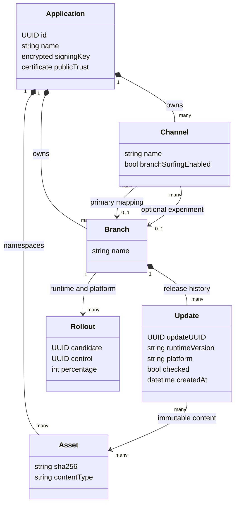

# Multi-app OTA architecture

This implementation extends xprem at upstream commit
`b46e13569f5734a66ed903f75f51b87b78e80c1b`. It serves Expo/React Native
applications using `expo-updates`. It delivers JavaScript and assets compatible
with an installed native runtime; it does not replace native application binaries.

Start with [operations](operations.md) to run the server and provision apps, then
use the [mobile integration guide](mobile-client.md). The rationale and acceptance
criteria are in [design decisions](decisions.md) and [security and performance](security-performance.md).

## Boundaries and identity

One deployment contains many apps. Each app has a stable UUID, its own signing
key pair, branches, channel mappings, update history, and object-store prefix.
The bootstrap creates `dev`, `uat`, and `prod`, each initially mapped to the branch
with the same name. Those names are a deployment convention; upstream supports
additional channels. Existing channel mappings are preserved on subsequent bootstrap runs.

The selection tuple is **app ID → channel → branch → runtime version → platform**.
Rollout eligibility also depends on the device's stable client ID. An update
without matching runtime/platform content is not eligible. A channel without a
mapping returns an error rather than falling back to another app or `prod`.
Missing app identity is rejected in this deployment.

Channels are release-routing boundaries. A mobile request's app/channel headers
are public selectors, not authenticated identities. Anyone who knows an app ID
can request its publicly delivered updates. Do not ship secrets in bundles.
Separate app IDs and signing keys reduce accidental cross-app delivery, but the
shared server and master key remain a shared administrative trust boundary.
Use separate deployments for environments that require independent administrators,
key custody, or private distribution. See the permission limitations below.

## UML deployment diagram

The checked-in [PlantUML deployment source](uml/deployment.puml) describes the
production topology. The Compose profile implements the single-host local variant;
TLS ingress, CDN, managed storage and multiple replicas are deployment steps, not
services silently provisioned by Compose.



This is a conceptual UML class diagram. The SQL migrations are the authoritative
physical schema; for example, channel experiment mappings and rollout status have
more fields than this diagram.

## Components

| Component | Responsibility | Reason |
| --- | --- | --- |
| Expo native updater | Fetch, validate signature/hashes, persist, and launch compatible updates | Native verification protects execution even if a CDN is compromised |
| TLS ingress | Separate public delivery from private administration; enforce request/body/rate limits | Reduce the public attack surface before requests reach Go |
| Go delivery service | Resolve app/channel/runtime/platform and return signed protocol responses | Keep update decisions in one tested implementation |
| Dashboard and publishing API | App/channel administration, upload validation, promotion and rollback | Require privileged credentials for release changes |
| PostgreSQL | Authoritative apps, mappings, checked updates, keys and jobs | Multi-app state must survive process restarts |
| Redis | Shared read caches, counters and coordination | Replicas share invalidation and avoid repeated database/storage work |
| Object store | App-scoped content-addressed immutable payloads | Deduplicate assets and separate large bytes from metadata |
| CDN | Deliver immutable assets near devices | Keep bandwidth and compression work off the API |
| CI | Build artifacts and publish approved releases using server-side credentials | Make production changes traceable to reviewed source |

See [UML component source](uml/components.puml) for interfaces and dependencies.
The Go router assembles delivery, publishing and administration services;
repositories isolate persistence, and provider adapters implement storage and CDN
delivery. The existing dashboard is reused.

## Publish sequence

```mermaid
sequenceDiagram
    autonumber
    actor Engineer
    participant CI as Protected CI environment
    participant API as xprem publishing API
    participant Store as App-scoped object store
    participant DB as PostgreSQL
    participant Cache as Redis
    Engineer->>CI: Approve app + channel + source revision
    CI->>CI: Export with matching native runtime and environment
    CI->>API: Request upload URLs (app token, branch, file hashes)
    API->>API: Authenticate credential and authorize app/action
    API-->>CI: Scoped upload grants for required files
    CI->>Store: Upload files (local mode uses API)
    CI->>API: Finalize update
    API->>Store: Validate required uploaded content
    alt Complete and valid
        API->>DB: Record checked update and rollout state
        API->>Cache: Invalidate latest update entries
        API-->>CI: Published update identity
    else Missing or invalid content
        API-->>CI: Reject; incomplete update is not eligible
    end
```

An upload finishing is not enough to make an update eligible. Finalization validates
the payload and marks the release checked. The stock publish CLI performs this flow.
Promote reviewed artifacts through dev → uat → prod using the actual commands in
the operations guide. Environment-specific configuration must match the target
binary; blindly moving a dev bundle to prod can preserve dev API URLs.

## Delivery sequence

```mermaid
sequenceDiagram
    autonumber
    participant App as Mobile application
    participant Native as expo-updates native runtime
    participant API as xprem delivery API
    participant Cache as Redis
    participant DB as PostgreSQL
    participant CDN as CDN / object store
    App->>Native: Check on foreground (throttled, jittered)
    Native->>API: GET /manifest (app, channel, runtime, platform, current UUID)
    API->>Cache: Resolve app, mapping and update envelope
    opt Cache miss
        API->>DB: Load app-scoped compatible checked release
        DB-->>API: Matching release / none
        API->>Cache: Cache with bounded freshness
    end
    API->>API: Apply device rollout decision
    alt Update available
        API-->>Native: Signed manifest, no-store
        Native->>Native: Verify pinned certificate and manifest
        Native->>API: GET /assets for exact content
        API-->>Native: Bytes or CDN redirect
        Native->>CDN: Download immutable assets if redirected
        Native->>Native: Verify hashes; persist complete update
        Native-->>App: isUpdatePending
        App->>App: Wait for safe user-approved restart
        App->>Native: reloadAsync()
        Native->>Native: Launch validated downloaded update
    else Already current / no compatible release
        API-->>Native: Protocol no-update directive
        Native-->>App: Continue current bundle
    else Network or validation failure
        Native-->>App: Error; continue current or embedded bundle
    end
```

Listening means observing `expo-updates` state. This deployment does not add a
WebSocket/SSE push-to-device service. An optional push notification can hint that a
check is useful, but the manifest and native verifier must still decide eligibility.

## Cache and consistency model

Manifest decisions and branch lists use `private, no-store`, including errors.
Assets use immutable caching only when their identity is pinned; headers that
affect asset selection appear in `Vary`. The CDN should cache app-scoped object
paths, not arbitrary `/manifest` responses. Redirects and negotiated delta patches
are not shared-cacheable. Configure the CDN to respect these policies.

Application caches include app identity and the relevant version/branch/runtime/
platform/content identity. Legacy asset metadata also separates launch/regular
asset roles, extensions, and public origin. Hash computation streams data with
bounded parallel reads. SHA-256 establishes integrity; legacy MD5 values remain
protocol identifiers only.

Upstream freshness bounds in `internal/services/protocol_cache.go` include app
configuration at 10 seconds and channel mapping at 5 seconds. Latest-update
envelopes have a 60-second TTL and explicit invalidation on release changes.
Redis shares that invalidation across replicas. In-memory caches on multiple
replicas can retain an older decision until TTL expiry. Mobile check intervals add
their own delay. An operational rollback is therefore not instantaneous on every
device, especially offline devices.

Redis loss is not permission to serve another app or channel. Reads fall back to
authoritative repositories where implemented; that increases database load.
Some cache-backed security/coordination behavior has different failure semantics,
so monitor Redis and test failures before production. In particular, upstream
credential throttling fails open when cache reads fail; an independent ingress
rate limit is required.

## Rollback and failure behavior

Republishing a known-good compatible release gives it a new release identity so
devices can move forward to safe content. Rollback-to-embedded uses the Expo
directive and must be exercised on both native platforms. Keep known-good assets
available through the recovery window. Clearing the database or rotating the
app UUID is not a rollback strategy.

On SIGTERM the server stops accepting new connections, drains requests for up to
30 seconds, then closes remaining connections. Dependencies stay available during
the drain; Compose allows 40 seconds before forced termination. `/hc` is liveness;
`/ready` only indicates initialization completed, not continuous verification of
every downstream dependency. Use separate dependency monitoring and a real
manifest synthetic check.

## Permission and licensing boundary

Core OTA distribution and multi-app/channel support are reused from xprem.
Per-key branch restrictions, advanced roles, audit logs, SSO and other enterprise
features are governed by upstream's `ee/` license and capability checks. This
implementation does not remove those checks or claim those features are available
without the required entitlement. Read the repository's `CONTRIBUTING.md` and
`ee/LICENSE` for the product boundary.

In the core deployment an app publishing token must be treated as powerful across
that app's branches. Use protected CI environments, keep administration on a
private network, and restrict who can obtain tokens. Strong server-enforced
separation between dev and prod publishers requires the relevant upstream
authorization feature or separate trust domains. Client channel headers alone
cannot provide that separation.
