# Mobile integration with the OTA server

This guide connects an existing Expo or React Native application using `expo-updates` to this repository. The server delivers JavaScript and assets for a compatible installed native runtime. It cannot install a new native dependency, change an entitlement or permission, or replace the native application binary.

The [copyable examples](../examples/mobile/README.md) implement checking after launch and foregrounding, listening to native update state, downloading a verified update, and offering a user-controlled restart. They use the xprem endpoints and headers implemented in this repository. These examples are for Android and iOS release builds; they are not a new mobile application.

## 1. Register each application and environment

Create one application registration per product in the xprem dashboard. Record its App ID and download its **public code-signing certificate** from App Info. Each application has its own signing identity. Create the `dev`, `uat`, and `prod` channels within each application and map each channel to the appropriate release branch. Channel names are scoped to an application, so two products can both use `prod`.

| Product | Header `expo-app-id` | Header `expo-channel-name` | Example branch |
| --- | --- | --- | --- |
| Consumer app | Consumer application's UUID | `dev` | `dev` |
| Consumer app | Consumer application's UUID | `uat` | `uat` |
| Consumer app | Consumer application's UUID | `prod` | `prod` |
| Agent app | Agent application's UUID | `prod` | `prod` |

The device selects a channel; the server maps it to a branch and resolves the platform/runtime and rollout cohort. A branch can hold releases for multiple native runtimes. Publishing to a branch does not create the channel mapping automatically.

The source wire contract is implemented in [`manifest_handler.go`](../internal/handlers/manifest_handler.go):

| Request field | Owner |
| --- | --- |
| `expo-app-id`, `expo-channel-name` | Set through `updates.requestHeaders` at native build time |
| `expo-platform`, `expo-runtime-version`, `expo-protocol-version` | Supplied by the native SDK; supported platforms are `android` and `ios` |
| `expo-expect-signature` | Native SDK requests signing when configured with a certificate |
| `expo-current-update-id`, `expo-embedded-update-id` | Native SDK identifies running and embedded releases; embedded ID enables rollback |
| `EAS-Client-ID` | Native SDK device identity used by deterministic rollout selection; not a login token |
| `xprem-branch` | Optional branch-surfing override; omitted by this example |

Use protocol version 1 clients for rollback support. Do not set native-managed headers manually or fetch `/manifest` as ordinary JSON: it is an Expo multipart protocol response.

**App IDs and channel names are routing information, not secrets or authentication.** The public manifest and asset routes intentionally accept device requests without a publisher token. A modified client can request another public channel. Do not put confidential information in bundles or treat a channel as an authorization boundary. Restrict business APIs independently. For separate environment signing trust, use separate application registrations/keys or server deployments; channels within one application share that application's signing key. Keep branch surfing disabled for normal release channels and do not add a channel switcher to production clients.

## 2. Install the native integration

From the existing mobile project:

```bash
npx expo install expo-updates
```

Use the version selected for the app's Expo SDK and commit the resulting lockfile. A bare React Native project also needs Expo modules and native configuration; follow the [official existing React Native installation instructions](https://docs.expo.dev/bare/installing-updates/) for its SDK. Do not copy the server repository's preview SDK application dependencies into a stable production app.

Copy [app.config.ts](../examples/mobile/app.config.ts) into your mobile project and merge it with any existing dynamic configuration. Keep your existing `name`, `slug`, plugins, icons, and platform configuration. The example explicitly defines the OTA settings and fails the build/export when its required environment is missing.

| Build variable | Example / reason |
| --- | --- |
| `OTA_APP_ID` | UUID copied from this product's dashboard registration; isolates product routing |
| `OTA_CHANNEL` | Exactly `dev`, `uat`, or `prod`; no default prevents accidental production targeting |
| `OTA_MANIFEST_URL` | `https://updates.example.com/manifest`; HTTPS protects transport |
| `OTA_CERTIFICATE_PATH` | `./certs/consumer-certificate.pem`; public certificate matching the App ID |
| `OTA_RUNTIME_VERSION` | `consumer-native-1`; explicit native compatibility contract |

Set these as ordinary build/export environment variables. None is a secret. Set them identically when creating a native build and when exporting an update for that build. The `eoas` CLI invokes Expo config with automatic dotenv loading disabled, so shell/CI environment variables must be explicitly available; do not depend on an unexported `.env` file. The example uses `OTA_CHANNEL`, not the upstream demo's `RELEASE_CHANNEL`.

For simultaneous installation, assign distinct Android package names and iOS bundle identifiers to `dev`, `uat`, and `prod` variants in your existing app configuration. Verify each variant's app name, backend API URL, and OTA channel before distributing it. App IDs on this server are independent of Apple bundle identifiers, Android package names, and EAS project IDs.

Example shell environment for an already registered development app:

```bash
export OTA_APP_ID='replace-with-the-dashboard-app-uuid'
export OTA_CHANNEL='dev'
export OTA_MANIFEST_URL='https://updates.example.com/manifest'
export OTA_CERTIFICATE_PATH='./certs/consumer-certificate.pem'
export OTA_RUNTIME_VERSION='consumer-native-1'
npx expo config --type public
npx expo run:android --variant release
# On a configured macOS/iOS build host:
# npx expo run:ios --configuration Release
```

Replace the UUID before running: the example deliberately rejects placeholder identities. A managed build service can run the same configuration with these variables set in the chosen build profile. Set the OTA variables on the machine that evaluates the config as well as on the build worker.

The example sets `checkAutomatically: 'ON_ERROR_RECOVERY'`, retains the embedded update and built-in recovery safeguards, and uses a zero startup waiting budget. Its foreground hook owns normal checks, so launch does not wait for the update network. The certificate and request headers are native build configuration. Rebuild the native app after changing them. See [Expo's configuration reference](https://docs.expo.dev/versions/latest/config/app/).

## 3. Set and preserve native compatibility

The server matches **App ID + channel mapping + platform + runtimeVersion**. It does not inspect JavaScript for native API compatibility. With the example's explicit runtime string, the mobile team must increment `OTA_RUNTIME_VERSION` for changes to native code, native dependencies, SDK version, permissions, native configuration, or signing certificate. Retain older compatible releases for installed binaries on earlier runtimes.

Expo also supports `runtimeVersion: { policy: 'fingerprint' }`; the bundled `eoas` CLI resolves it through the app's installed `expo-updates` CLI. Teams can adopt it instead of the example's explicit value after validating build/export reproducibility. Compare the resolved runtime for **each platform** in CI. Do not change runtime policy mid-release or manually force a mismatched bundle into an existing runtime. See [Expo runtime versions](https://docs.expo.dev/eas-update/runtime-versions/).

Database migrations and persisted client data must tolerate rollback to older JavaScript. The server cannot undo a destructive client-side data migration.

## 4. Listen, check, download, and apply

Copy [ota-controller.ts](../examples/mobile/ota-controller.ts), [useOtaUpdates.ts](../examples/mobile/useOtaUpdates.ts), and [UpdateBanner.tsx](../examples/mobile/UpdateBanner.tsx) into your application. Mount the hook once near the app root and pass its return value through your application context or props. It has one module-level coordinator to serialize native operations.

```tsx
function AppRoot() {
  const ota = useOtaUpdates();
  return (
    <>
      <ApplicationNavigation />
      <UpdateBanner
        ota={ota}
        canRestart={!isPaymentOrOtherCriticalFlowActive}
        saveDrafts={persistUnsavedWork}
      />
    </>
  );
}
```

The application must supply the navigation, transaction guard, and asynchronous draft-saving function shown above. Restarting replaces the JavaScript runtime: complete persistence before `applyUpdate()` and do not rely on code after `reloadAsync()` to execute.

| API used by the example | Responsibility |
| --- | --- |
| `Updates.useUpdates()` | Observes the local native updater's state, errors, and pending download |
| `Updates.checkForUpdateAsync()` | Requests an update decision |
| `Updates.fetchUpdateAsync()` | Downloads/verifies/caches the selected update or stages a rollback |
| `Updates.reloadAsync()` | Restarts into the pending update after the user's choice |

`isRollBackToEmbedded` requires handling even though `isAvailable` is false. The coordinator covers both cases. A successful check alone is insufficient to show a restart button; download must finish. The native SDK checks the manifest signature against the embedded certificate and verifies asset integrity. Use its downloader rather than evaluating downloaded JavaScript yourself. See the [Expo Updates API](https://docs.expo.dev/versions/latest/sdk/updates/).

The example's scheduling decisions are deliberate:

- It starts an automatic check after a random delay of up to ten seconds on launch/foreground, spreading synchronized traffic without blocking app use.
- Successful automatic checks have a fifteen-minute cooldown. Consecutive failures increase it to thirty, then sixty minutes, with additional jitter. These are product defaults to tune against measured load.
- It checks only while active. It removes the foreground listener and timer on unmount. An already started native download may finish after backgrounding; the JavaScript API does not provide cancellation here.
- A manual check is limited to once per thirty seconds. Concurrent checks/downloads/restarts are serialized. Once an update is ready, the pending download is retained until a restart.
- It waits for a running native startup procedure to finish, avoiding a competing manual operation during error recovery.
- It downloads automatically on these checks, including cellular networks. For a Wi-Fi-only or user-approved download policy, gate the check/download call with the app's connectivity/consent policy; connectivity hints do not replace error handling.

**“Listen” means local state subscription plus foreground polling.** This server does not supply an OTA WebSocket, SSE, or push-notification stream. There is no promise of immediate delivery to a backgrounded or terminated app. An optional push system can hint that a future check is useful, but update bytes and trust decisions must still come through `expo-updates`. The example does not poll continuously while an app remains open; a user can check manually, or a later foreground triggers the next eligible check.

## 5. Publish with the same environment

Use the repository's matching `eoas` CLI release (the imported CLI source is version `2.3.0`) and pin it in the mobile project's development dependencies. With that CLI installed:

```bash
# Run from the mobile project, with OTA_* already exported for the target build.
# Inject EOO_TOKEN from the CI secret store; do not put it in source or app config.
npx --no-install eoas publish --branch dev --platform all --nonInteractive
```

Change both the channel environment and target branch deliberately for `uat` and `prod`. `--branch` controls the published branch; it does not rewrite the binary's channel. The CLI reads `expo-app-id` from Expo config and uses `updates.url` to locate the server. If the protected publishing origin differs from the public update origin, use the supported `--serverUrl https://ota-admin.example.com` flag. This leaves the mobile update URL unchanged.

Test the downloaded release on UAT binaries for each platform and runtime before making it available to production. Keep CI publisher credentials separate by application/environment to the extent supported by the deployed control plane, and protect production publishing in the CI environment. Do not claim that a channel header itself enforces publisher permissions.

## 6. Signing and secrets

Commit the **public certificate** with the mobile project and compare its fingerprint with the trusted server registration before the first native release. The example requires signing for all three channels and uses the server's actual `keyid: 'main'` and `alg: 'rsa-v1_5-sha256'`. Never include `EOO_TOKEN`, storage credentials, master encryption keys, or the signing private key in Expo config, `EXPO_PUBLIC_*`, bundles, request headers, or the mobile repository.

This server signs responses with the application's server-held private key, unlike the EAS CLI signing workflow. This protects against forged CDN/bucket content, but an attacker controlling the server and its signing key can sign malicious updates. Protect publishing access and the server key store accordingly. Signing authenticates code; it does not make downloadable code confidential.

Certificate/key rotation requires a new native build with a new runtime. This implementation uses one active key per application and emits `keyid="main"`; replacing that key stops older binaries from trusting newly served responses. It does not provide concurrent per-runtime signing keys. Plan a separate application registration/signing identity for a transition cohort if old and new binaries must continue receiving updates together. Do not rotate only the server key and assume old installed clients can recover the new certificate over OTA. Expo explains the native certificate requirement in its [code-signing guide](https://docs.expo.dev/eas-update/code-signing/).

## 7. Failure handling and diagnostics

| Situation | Client behavior / action |
| --- | --- |
| Offline, timeout, 429, or transient 5xx | Keep using the running app; show a non-blocking retry message; use cooldown before another automatic attempt |
| Unknown app/channel (404) | Verify the embedded headers and channel mapping; do not switch to another application's channel |
| Missing/malformed headers (400) | Verify a native release build and its baked configuration; JS config changes alone do not repair the binary |
| No compatible update | Continue current/embedded app; compare platform and exact runtime string before publishing |
| Signature/hash failure | Reject the download; investigate certificate/key mismatch or altered assets; never disable verification to recover |
| Downloaded, restart deferred | Keep current app; offer restart later; the native updater can apply the cached update on a later cold launch |
| Early launch failure | Native recovery may select a usable cached/embedded update; test this on the actual SDK and do not assume recovery from every crash |
| Bad update already running | Publish a corrected compatible release or stage the server's rollback directive; the hook handles rollback as a pending update |

For diagnostics record the app/channel from your trusted build metadata, `Updates.runtimeVersion`, `Updates.updateId`, `Updates.isEmbeddedLaunch`, and `Updates.isEmergencyLaunch`. Record update check/download duration and error category through your existing telemetry. Treat an update ID seen after restart as evidence of activation; a manifest request or completed download alone does not prove successful startup. Redact signed asset URLs, tokens, and personal data from logs. The sample UI intentionally displays a generic error instead of raw server messages.

## UML sequence: normal delivery and consent

```mermaid
sequenceDiagram
    autonumber
    actor User
    participant App as Mobile UI / hook
    participant SDK as Native expo-updates
    participant Server as xprem manifest API
    participant Store as Object storage / CDN
    User->>App: Launch or foreground
    App->>App: Jitter, cooldown, single-operation guard
    App->>SDK: checkForUpdateAsync()
    SDK->>Server: GET /manifest (app, channel, platform, runtime, device headers)
    Server->>Server: Resolve app-scoped channel, runtime, rollout
    alt No eligible update
        Server-->>SDK: noUpdateAvailable directive
        SDK-->>App: No update
    else Eligible release or embedded rollback
        Server-->>SDK: Signed manifest / directive
        SDK-->>App: Available or isRollBackToEmbedded
        App->>SDK: fetchUpdateAsync()
        SDK->>Server: Fetch current eligible manifest / directive
        Server-->>SDK: Signed response
        opt Normal update with uncached assets
            SDK->>Store: GET immutable bundles/assets
            Store-->>SDK: Asset bytes
        end
        SDK->>SDK: Verify signature and hashes; stage atomically
        SDK-->>App: useUpdates(): pending
        App-->>User: Offer restart
        User->>App: Accept at a safe point
        App->>App: Persist drafts; finish critical transaction
        App->>SDK: reloadAsync()
        SDK->>SDK: Launch pending verified update / embedded bundle
    end
```

## UML state machine: update lifecycle

```mermaid
stateDiagram-v2
    [*] --> Running
    Running --> Checking: Eligible launch / foreground / manual action
    Checking --> Running: No compatible update
    Checking --> Downloading: Update or rollback available
    Checking --> RecoverableError: Network / protocol error
    Downloading --> Ready: Verified and cached / rollback staged
    Downloading --> Running: Release no longer available
    Downloading --> RecoverableError: Download / integrity failure
    RecoverableError --> Checking: Later eligible retry
    Ready --> Ready: User defers; current app continues
    Ready --> Restarting: User accepts after saving
    Ready --> Restarting: Native cold launch uses pending update
    Restarting --> Ready: Restart API rejects
    Restarting --> Running: New verified update / embedded bundle launches
    Running --> EmbeddedFallback: Native recovery when applicable
    EmbeddedFallback --> Checking: Future eligible check
```



## Release verification on real devices

Before production, run this matrix on Android and iOS release binaries. Expo Go and ordinary development builds do not exercise the production updater. These device checks require your actual mobile applications and certificates; the server repository cannot establish them through TypeScript checks alone.

1. Publish a visibly identifiable change to app A/dev. App A/dev receives it; A/uat, A/prod, and app B do not.
2. Publish an incompatible runtime and confirm the installed binary retains its running release.
3. Download a compatible release, defer restart, complete a critical flow, save drafts, then accept. Verify the new `updateId` after restart.
4. Test launch/foreground offline, intermittent download failure, a missing asset, signature failure, repeated foreground events, and two simultaneous manual checks.
5. Publish an embedded rollback directive while the app is on an OTA update. Confirm it is staged despite `isAvailable=false`, then launches the embedded release after restart.
6. Test a failing release and persisted-data compatibility through native recovery and rollback. Verify the app remains usable after download or restart errors.
7. Measure launch time, check duration, downloaded bytes, restart success, and foreground request frequency on representative devices and networks.

The example package includes TypeScript validation against real Expo SDK 57 types and focused coordinator tests. Native signing, build configuration propagation, and device recovery still require the matrix above.
